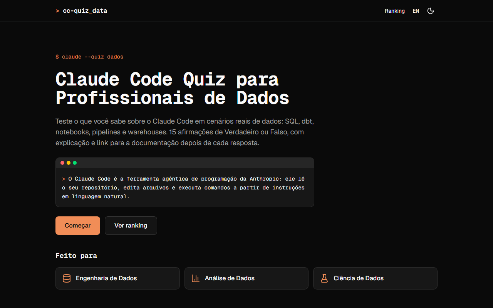
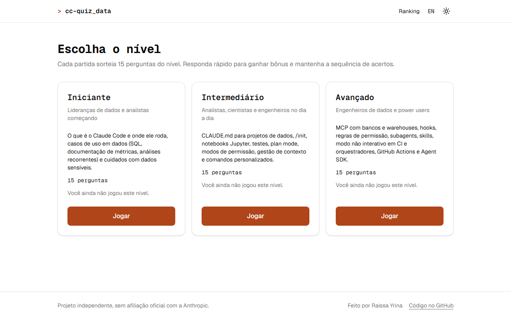
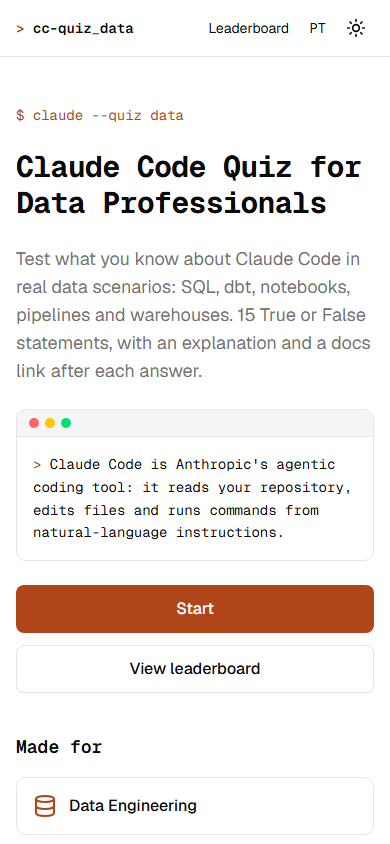

# Claude Code Quiz para Profissionais de Dados

Quiz de Verdadeiro ou Falso sobre o **Claude Code** em cenários reais de dados (SQL, dbt, notebooks, pipelines, warehouses), feito para engenheiros(as), analistas e cientistas de dados. São 3 níveis e partidas de 15 afirmações sorteadas, com explicação e link para a documentação oficial depois de cada resposta, além de ranking global e resultado compartilhável.

A especificação completa está em [`../prd.md`](../prd.md).



| Escolha de nível (tema claro)                        | Mobile (EN)                                         |
| ---------------------------------------------------- | --------------------------------------------------- |
|  |  |

## O que ele faz

- **3 níveis × 30 perguntas**, validadas contra a doc vigente do Claude Code. Cada partida sorteia 15 sem repetição (Fisher-Yates com RNG criptográfico), com 5 a 10 respostas "Verdadeiro".
- **Pontuação no servidor**: base por nível, bônus por rapidez e multiplicador de sequência de acertos. O tempo é medido pelo relógio do servidor, e recarregar a página não zera o cronômetro.
- **O gabarito nunca vai para o cliente antes da resposta.** A pergunta chega sem o campo `answer`; a resposta certa, a explicação e o link só vêm depois do `POST` da resposta.
- **Ranking global** por nível, com apelido validado, filtro de palavrões PT/EN, rate limit por IP e destaque da posição do jogador mesmo fora do top 50.
- **Resultado compartilhável** em `/r/<id>`, com OG image dinâmica no estilo terminal e botões de LinkedIn, X, WhatsApp, copiar link e Web Share API.
- **PT-BR e EN**, tema claro/escuro sem flash, navegação 100% por teclado (`V`/`F`, setas + Enter) e zero violações sérias de axe.

## Arquitetura

```
Navegador (Client Components)
   │  fetch JSON
   ▼
Route Handlers /api/*  ──── lê content/questions/*.json (bundle do servidor)
   │  supabase-js com a chave service_role (server-only)
   ▼
Supabase Postgres: quiz_sessions · session_answers · leaderboard_entries · rate_limits
                   view question_stats · RPCs rate_limit_hit e leaderboard_position
```

O servidor é a fonte da verdade: sorteio, tempo, pontuação, posição no ranking e rate limit são calculados lá. O banco fica fechado (RLS sem policies e `revoke` de `anon`/`authenticated`), e só os Route Handlers falam com ele.

| Caminho                            | Papel                                                                     |
| ---------------------------------- | ------------------------------------------------------------------------- |
| `lib/scoring.ts`                   | Fórmula de pontuação, função pura com 100% de cobertura                   |
| `lib/session.ts`                   | Regras da partida (aplicar resposta, expiração, resumo), sem banco        |
| `lib/questions/`                   | Schema Zod, loader e sorteio das perguntas                                |
| `lib/db/`                          | Único ponto de acesso ao Postgres                                         |
| `lib/rate-limit.ts`, `nickname.ts` | Janela fixa por IP e validação do apelido (cliente e servidor)            |
| `app/api/`                         | Sessões, respostas, ranking e OG image                                    |
| `app/[locale]/`                    | Home, níveis, partida, resultado, ranking e página pública `/r/[shareId]` |

## Stack

Next.js 16 (App Router) · TypeScript strict · Tailwind + shadcn/ui · next-intl · next-themes · Zod · Supabase Postgres · `next/og` · Vercel Analytics + Speed Insights · Vitest + Testing Library · Playwright + axe · GitHub Actions · Vercel.

## Como rodar localmente

Requisitos: Node 22+, pnpm (via `corepack enable`) e Docker rodando, para o Supabase local.

```bash
pnpm install
pnpm db:start     # Supabase local (Postgres + API) e aplica as migrations
cp .env.example .env.local   # preencha com `pnpm supabase status -o env`
pnpm dev          # http://localhost:3000
```

Banco: `pnpm db:migrate` aplica migrations novas, `pnpm db:reset` recria o banco do zero e `pnpm db:stop` desliga o stack.

## Testes e CI

```bash
pnpm lint
pnpm typecheck
pnpm test               # Vitest: unidade, componentes e Route Handlers (banco em memória), com cobertura
pnpm test:integration   # lib/db contra o Supabase local (pnpm db:start)
pnpm build && pnpm test:e2e              # Playwright + axe: páginas que não precisam do banco
pnpm build && E2E_DB=1 pnpm test:e2e     # inclui partida, ranking e compartilhamento (Supabase local no ar)
```

Em todo PR, o GitHub Actions roda install → lint → typecheck → test → Supabase local → integração → build → E2E completo, em desktop e em mobile de 320px. Um workflow semanal roda `pnpm check:links` para conferir se todo `docUrl` ainda responde 200.

## Decisões técnicas

- **Next.js 16 com `cacheComponents` desligado.** O scaffold do Next 16 liga Cache Components por padrão. Com ele, `revalidate` vira `cacheLife`, `params` e `cookies()` precisam ficar dentro de `<Suspense>`, e a integração com o next-intl fica mais frágil. Para o PRD, o modelo clássico basta: home e `/play` continuam estáticas via `generateStaticParams`.
- **`proxy.ts` no lugar de `middleware.ts`.** É o novo nome da convenção no Next 16. Ele roda o middleware do next-intl para detectar o idioma (cookie `NEXT_LOCALE`, depois `Accept-Language`).
- **Concorrência na resposta com update otimista**, sem RPC: `update ... where current_index = $posição`. Assim a fórmula de pontuação vive só em TypeScript (`lib/scoring.ts`), sem duplicação em SQL.
- **Cenário de dados medido por um campo explícito.** Cada pergunta tem `dataScenario: boolean`, e um teste exige ≥ 70% por nível.
- **Pontuação máxima calculada pela fórmula** (beginner 3.150, intermediate 4.731, advanced 6.300), somando `calculateScore` pergunta a pergunta. O plano previa 4.730, mas o arredondamento por pergunta (247,5 → 248, 292,5 → 293, 337,5 → 338) dá 4.731. O exemplo "1.840 / 2.520" do PRD é ilustrativo.
- **Links da doc em `code.claude.com/docs/en/*`, sem redirect.** A documentação do Claude Code migrou de domínio. Cada `docUrl` usa a URL canônica atual, e o `pnpm check:links` exige 200 sem seguir redirects, para acusar a próxima migração.
- **`check:links` roda direto no Node** (`scripts/check-links.mts`), que já executa TypeScript nativamente, sem `tsx` como dependência.
- **Banco de perguntas validado contra a doc vigente (out/2026).** Algumas sementes do PRD mudaram de resposta: o modo inicial padrão passou a ser `auto` (as perguntas de permissão falam do modo Manual), o plan mode pode rodar comandos de exploração (as perguntas tratam de edição) e os comandos personalizados viraram skills.
- **Banco fechado por padrão.** RLS ligado nas 4 tabelas, sem policies, e `revoke all` de `anon`/`authenticated`, inclusive nos default privileges, para que objetos de migrations futuras também nasçam fechados. A view `question_stats` usa `security_invoker`. Só a chave `service_role`, nos Route Handlers, acessa os dados.
- **Supabase local enxuto.** O `config.toml` desliga realtime, storage, e-mail, edge functions e analytics. O auth continua ligado porque é ele que emite as chaves `anon`/`service_role` que o PostgREST valida.
- **Cliente Supabase criado sob demanda** (`getSupabase()`): o build não precisa das variáveis, e a primeira requisição falha com os nomes das que faltam.
- **Acesso ao banco isolado em `lib/db/`.** A lógica da partida (`lib/session.ts`) é pura e testada sem banco. Os testes de API trocam `lib/db/sessions` por uma versão em memória com as mesmas garantias (PK e update condicionado ao índice), e `lib/db/` tem testes próprios contra o Postgres local (`pnpm test:integration`), fora da cobertura unitária.
- **Ordem na resposta: insere em `session_answers`, depois avança a sessão.** A PK `(session_id, position)` barra a resposta duplicada antes de qualquer mudança na sessão, e o `update ... where current_index = $posição` é a segunda barreira.
- **Última atividade = `current_served_at`.** Ele é gravado na criação e a cada resposta, quando a próxima pergunta é entregue, então já equivale a max(`created_at`, último `answered_at`) sem uma consulta extra.
- **`cn` do shadcn** no lugar de `clsx` + `tailwind-merge`. É o utilitário que o shadcn instala hoje, e exige Node ≥ 22.
- **Scripts de build negados no pnpm** (`pnpm-workspace.yaml`) para `@parcel/watcher` e `@swc/core`. Eles servem só ao extrator de mensagens do next-intl, que o projeto não usa.
- **Cache do ranking na CDN, não no Next.** `GET /api/leaderboard` depende da query (nível, período, limit), e o `revalidate` de rota ignora a query. Por isso a resposta sai com `Cache-Control: public, s-maxage=30, stale-while-revalidate=30`, e a Vercel guarda uma cópia por URL. A página `/ranking` é dinâmica, porque lê a query e destaca o jogador (`?me=<shareId>`), e consulta o banco direto, sem passar pela API.
- **Rate limit em janela fixa com upsert atômico.** A RPC `rate_limit_hit` faz `insert ... on conflict do update set count = count + 1 returning count`, então requisições simultâneas não se perdem. A chave é `<escopo>:<hash do IP>:<início da janela>`, e cada chamada apaga as janelas vencidas. Passar do limite devolve `429 RATE_LIMITED` com `Retry-After`.
- **Posição no ranking calculada no Postgres** (RPC `leaderboard_position`), com o mesmo desempate do índice (score desc, tempo asc, data asc). Ela serve tanto ao `POST .../leaderboard` quanto ao destaque fora do top 50.
- **O placar do ranking vem da sessão no banco.** O cliente manda só o apelido. O unique em `leaderboard_entries.session_id` é o que impede o segundo registro, inclusive em requisições simultâneas.
- **Filtro de palavrões em duas listas.** Palavras inequívocas são barradas em qualquer posição ("xporrax"). As que aparecem dentro de palavras comuns ("puta" em "disputa", "cu" em "cursor") só são barradas como palavra inteira. Antes da comparação, dígitos viram letras (`sh1t`) e os separadores são removidos (`p.u.t.a`).
- **Página pública `/r/[shareId]` com `noindex`.** Ela serve ao preview nas redes, não à busca. Mostra só placar, acertos, tempo e faixa, sem as perguntas, e só existe para partidas concluídas. O apelido aparece quando a partida entrou no ranking; antes disso, "Anônimo".
- **OG image em Route Handler (`/api/og/[shareId]`)**, como no PRD, referenciada pelo `generateMetadata` da página com `metadataBase` vindo de `NEXT_PUBLIC_SITE_URL` (ou `VERCEL_URL` nos previews). Usa a Geist que já vem com o `next/og`, sem baixar fontes, e monta o tradutor com `createTranslator`, porque a rota fica fora da árvore de páginas do next-intl. Cache de 5 min, já que o apelido pode surgir depois.
- **Web Share API além dos links, não no lugar deles.** Quando o navegador tem `navigator.share` (em geral no mobile), aparece um botão "Compartilhar…" extra; LinkedIn, X, WhatsApp e copiar link ficam sempre visíveis.
- **`quiz_completed` disparado na tela de resultado**, que já tem placar e acertos, com trava no `sessionStorage` para recarregar a página não contar a partida duas vezes. `quiz_started` só conta partidas novas, não retomadas.
- **Taxa de acerto por pergunta na view `question_stats`** (criada na migration inicial). Para consultar: `select * from question_stats order by accuracy;` no SQL Editor do Supabase ou via `psql`.
- **CSP sem nonce.** Nonce exige renderização dinâmica em todas as páginas, e home e `/play` precisam ser estáticas (meta de performance). A política fica no `next.config.ts` com `script-src 'self' 'unsafe-inline'`, além de `frame-ancestors 'none'`, `X-Frame-Options: DENY`, `nosniff`, `Referrer-Policy` e `Permissions-Policy`. O Vercel Analytics roda na mesma origem (`/_vercel/*`), então não precisa de domínio extra fora do modo dev.
- **`hreflang` e canonical por página** (`lib/seo.ts`), com `x-default` em PT. O sitemap lista só home, `/play` e `/ranking` nos dois idiomas; partida, resultado e `/r` são `noindex`.
- **E2E com banco ligado por `E2E_DB=1`.** Os testes de partida, ranking e compartilhamento precisam do Supabase. No CI ele sobe com `supabase start` no Docker do runner; localmente, sem a variável, esses testes são pulados e o resto roda. Cada teste usa um `X-Forwarded-For` próprio para o rate limit de sessões não misturar os casos, e o gabarito vem dos próprios JSONs de perguntas, pelo id que a API entrega.
